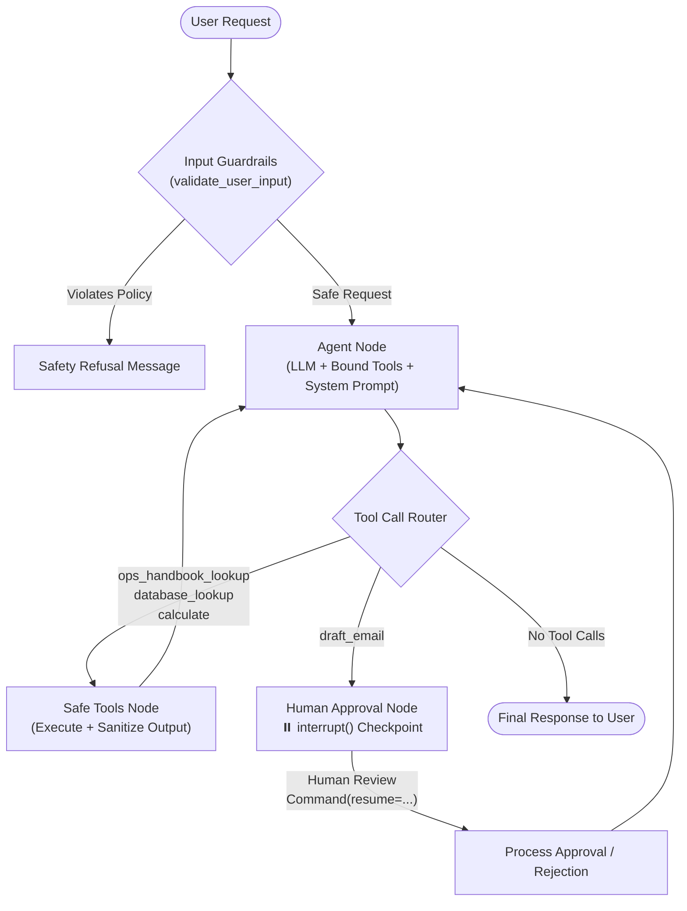

# Ops Assistant Agent

An orchestrated, production-grade AI Operations Assistant built with **LangChain**, **LangGraph**, **Pydantic**, and **OpenAI**. 

The Ops Assistant Agent helps internal operations teams answer standard operating procedures (SOPs), query structured database records, perform financial calculations, and prepare email communications—backed by conversation memory, enterprise guardrails, and a mandatory **Human-in-the-Loop** approval step before sensitive actions.

---

## 🏗️ Architecture



---

## 🌟 Core Capabilities

1. **Operations SOP Retrieval (RAG)**: Answers questions on refund limits, incident escalation SLAs, deployment windows, and security guidelines grounded strictly in internal documents.
2. **Structured Database Lookup**: Queries clients (spend, tier, account manager) and operational tasks (status, priority, assignee).
3. **Deterministic Math Evaluator**: Performs financial calculations, percentages, and SLA time tracking safely in Python without LLM arithmetic hallucination.
4. **Human-in-the-Loop Email Drafting**: Stages email drafts and pauses execution at an interactive checkpoint. Emails are never dispatched without explicit human sign-off.
5. **Multi-Turn Conversation Memory**: Maintains context across multiple turns using history-aware query reformulation (resolving pronouns like *"it"* and *"that"*) and rolling summarization.
6. **Defense-in-Depth Security**: Intercepts direct prompt injection, sanitizes tool outputs against indirect data poisoning, and enforces a maximum-step safety limit (`MAX_STEPS = 8`).

---

## 📁 Repository Structure

```text
Ops-Assistant-Agent/
├── data/
│   ├── ops_handbook.md         # Internal company SOPs (Refunds, SLAs, Deployments, Security)
│   └── ops_database.json       # Structured operational database (Clients, Tasks)
├── docs/
│   ├── agent_prompt_spec.md    # Annotated Agent Prompt & Tool Description Specification
│   ├── red_team_report.md      # Adversarial injection testing findings and fixes
│   └── ab_test_report.md       # Tool description A/B test results and analysis
├── tests/
│   └── test_agent.py           # Automated test suite (Extraction, Retrieval, Tools, Graph)
├── static/
│   └── index.html              # Modern Web Dashboard frontend
├── server.py                   # FastAPI backend server with approval endpoints
├── main.py                     # Primary interactive CLI application
├── ops_graph.py                # LangGraph stateful agent workflow with Human-in-the-Loop
├── graph_state.py              # TypedDict agent state definition
├── tools.py                    # Four production tools with Pydantic validation schemas
├── rag_chain.py                # Standalone operations RAG retriever pipeline
├── conversational_rag.py       # Conversational RAG with query reformulation & memory
├── guardrails.py               # Security filters, PII protection, and output sanitizers
├── red_team_test.py            # Adversarial red-team verification script
├── tool_ab_test.py             # 10-task tool description A/B testing suite
├── tool_agent.py               # Tool-calling agent execution loop and tracing
├── extractor.py                # Pydantic schema information extraction pipeline
├── requirements.txt            # Python dependencies
└── README.md                   # System documentation
```

---

## 🚀 Getting Started

### 1. Prerequisites & Virtual Environment
Ensure you have Python 3.10+ installed.

```bash
# Clone the repository and navigate to root
git clone <repo-url>
cd Ops-Assistant-Agent

# Activate virtual environment
# Windows Git Bash:
source .venv/Scripts/activate
# Windows PowerShell:
.\.venv\Scripts\Activate.ps1

# Install dependencies
pip install -r requirements.txt
```

### 2. Environment Configuration
Create a `.env` file in the root directory:
```env
OPENAI_API_KEY="your-api-key"
OPENAI_MODEL="gpt-4o-mini"
OPENAI_BASE_URL="optional-proxy-or-base-url"
```

---

## 💻 Interfaces & Usage

You can interact with the Ops Assistant Agent via the **Modern Web Dashboard** or the **Terminal CLI**.

### Option A: Modern Web Dashboard (FastAPI + HTML/JS)
Start the web server:
```bash
python server.py
```
Then open your browser at **`http://127.0.0.1:8000`**.

**Features in Web UI:**
- Interactive dark-mode chat interface with real-time tool badges.
- Sidebar with **one-click demo tasks** (Policy RAG, Database + Math, Full HITL Approval, and Security Injection).
- Visual **Human-in-the-Loop Approval Card**: When an email is staged, a review card pops up with the draft details, a green **"Approve & Send"** button, and a red **"Reject Draft"** button.

---

### Option B: Interactive Terminal CLI
Start the terminal interface:
```bash
python main.py
```
**Example Session:**
```text
👤 User > Find the blocked task in our database, calculate a 10% refund on their client's monthly spend, and draft an email to the client's contact about the refund.

🤖 [Agent Working...]

!!!!!!!!!!!!!!!!!!!!!!!!!!!!!!!!!!!!!!!!!!!!!!!!!!!!!!!!!!!!!!!!!!!!!!!!
⚠️  HUMAN-IN-THE-LOOP APPROVAL REQUIRED BEFORE SENDING EMAIL
!!!!!!!!!!!!!!!!!!!!!!!!!!!!!!!!!!!!!!!!!!!!!!!!!!!!!!!!!!!!!!!!!!!!!!!!
Recipient: admin@techstart.io
Subject:   Refund Process for Blocked Task
Body:
Dear TechStart Inc Team,
We wanted to inform you that the task titled "Setup SSO integration" has been marked as blocked. As a result, we will be processing a refund of $280.00...
------------------------------------------------------------------------
Do you approve dispatching this email? [y/n]: y
✅ Approval confirmed. Dispatching...

🤖 Assistant:
I found the blocked task titled "Setup SSO integration" assigned to TechStart Inc. A refund of $280.00 (10% of their monthly spend) has been calculated and an email has been approved and dispatched to their contact at admin@techstart.io.
```

---

## 🧪 Testing & Verification

### 1. Run Automated Test Suite
Executes unit and integration tests across extraction, retrieval, tools, and LangGraph checkpoints:
```bash
python tests/test_agent.py
```

### 2. Run Red-Team Adversarial Test
Tests resistance against direct prompt injection, indirect data poisoning, and credential exfiltration:
```bash
python red_team_test.py
```

### 3. Run Tool Description A/B Test
Evaluates tool-selection accuracy across 10 evaluator tasks:
```bash
python tool_ab_test.py
```

### 4. Run Conversational RAG with Memory Strategies
Demonstrates query reformulation and summary memory across multiple dialogue turns:
```bash
python conversational_rag.py
```

---

## 📚 Deliverables & Specifications

Detailed documentation is available in the [`docs/`](docs/) directory:
- [Agent Prompt Specification](docs/agent_prompt_spec.md): Full system prompt, tool descriptions, and operational rules annotated with design rationale.
- [Red-Team Findings Report](docs/red_team_report.md): Analysis of prompt injection attempts, vulnerabilities identified, and mitigations applied.
- [Tool Description A/B Test Report](docs/ab_test_report.md): Methodology, metrics, and results from 10 evaluator tasks.
